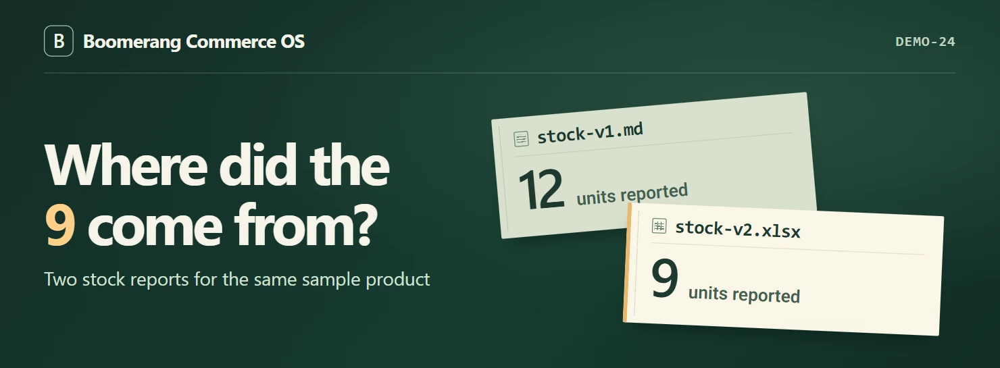
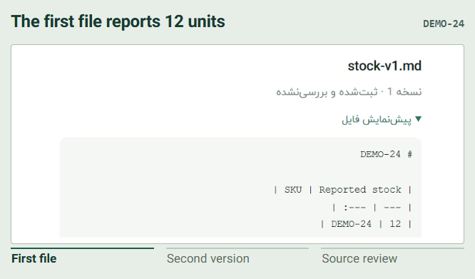
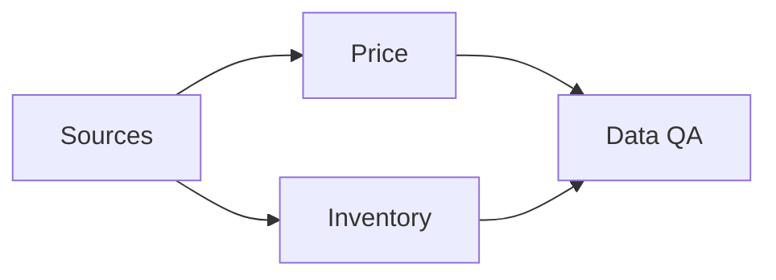

[فارسی](README.md)

# Boomerang Commerce OS

<picture>
  <source media="(max-width: 650px)" srcset="docs/readme/source-ledger-en-mobile.webp">
  
</picture>

A local workspace for preparing product data. Start a run for a product, attach its source files, and see which step is waiting and why. The run screen previews the latest file. SQLite keeps the originals and the run history.

## When two files disagree

In this example, the Markdown file reports **12 units** for `DEMO-24`. The revised Excel sheet reports **9**. The studio records the new file and leaves the `Sources` step waiting for review. The price and inventory steps both depend on that review.

<picture>
  <source media="(prefers-reduced-motion: reduce)" srcset="docs/readme/review-en.webp">
  
</picture>

## Try the same run

From the project directory, use Bun 1.4.2 or later on Linux or Ubuntu in WSL.

```sh
bun install --frozen-lockfile
bun run start
```

Open `http://127.0.0.1:4174` in a browser on the same machine. Both sample files are in `docs/examples`. The studio interface is in Persian.

1. Start a run with **اجرای اتوماسیون**. Enter `DEMO-24` as the product name, choose the first file and press **شروع اجرا**. [First file, Markdown](docs/examples/stock-v1.md)
2. On the source card, use **به‌روزرسانی فایل** to attach the second file. Open **پیش‌نمایش فایل** to see the spreadsheet row. [Second file, Excel](docs/examples/stock-v2.xlsx)
3. Expand **مرحله‌ها و وابستگی‌ها** (steps and dependencies) and select `Sources`. The inspector shows `WAITING_FOR_SOURCE_REVIEW`.

<details>
<summary>Where is the first file, and what waits for review?</summary>

Copy the ID after `#run/` in the address bar. On the same server, `GET /api/runs/{id}` returns both versions in `sourceDocuments`, newest first, with a version number and a SHA-256 digest for each file.



[Step dependencies in the code](src/application/product-automation.js) · [File versioning test](tests/simplified-api.test.js)

</details>

[Local runtime and SQLite guide](docs/implementation/runtime.md)
