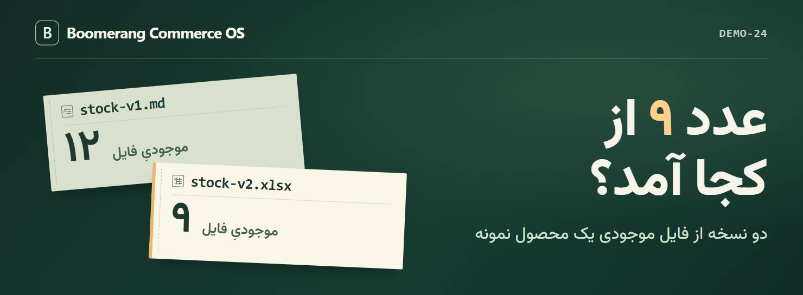
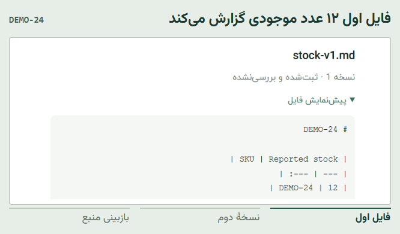
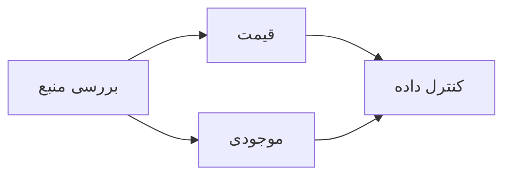

<p dir="rtl"><a href="README.en.md" lang="en">English</a></p>

<div dir="rtl" lang="fa">

# استودیوی اطلاعات محصول بومرنگ

<picture>
  <source media="(max-width: 650px)" srcset="docs/readme/source-ledger-fa-mobile.webp">
  
</picture>

در این استودیوی محلی برای هر محصول یک پرونده باز می‌کنی. فایل‌های منبع را به آن اضافه می‌کنی، آخرین نسخه را می‌بینی و می‌فهمی بررسی قیمت یا موجودی کجا منتظر مانده و چرا. اصل فایل‌ها و سابقهٔ اجرا در SQLite می‌ماند.

## وقتی عددِ دو فایل فرق دارد

در این نمونهٔ آموزشی، فایل Markdown برای محصول `DEMO-24` موجودی **۱۲ عدد** گزارش می‌کند. در فایل Excel بعدی عدد **۹** آمده است. فایل دوم ثبت می‌شود و مرحلهٔ `Sources` منتظر بررسی می‌ماند. وقتی این مرحله تکمیل شود، نوبت بررسی قیمت و موجودی می‌رسد.

<picture>
  <source media="(prefers-reduced-motion: reduce)" srcset="docs/readme/review-fa.webp">
  
</picture>

## همین نمونه را امتحان کن

با Bun نسخهٔ ۱٫۴٫۲ یا جدیدتر، روی لینوکس یا Ubuntu در WSL، این دو فرمان را در پوشهٔ پروژه اجرا کن.

```sh
bun install --frozen-lockfile
bun run start
```

بعد `http://127.0.0.1:4174` را در مرورگر همان سیستم باز کن. هر دو فایلِ این تمرین در پوشهٔ `docs/examples` هستند.

1. روی «اجرای اتوماسیون» بزن. نام محصول را `DEMO-24` بگذار، فایل اول را انتخاب کن و «شروع اجرا» را بزن. [فایل اول، Markdown](docs/examples/stock-v1.md)
2. در کارت «فایل منبع»، «به‌روزرسانی فایل» را بزن و فایل دوم را انتخاب کن. «پیش‌نمایش فایل» حالا ردیف اکسل را نشان می‌دهد. [فایل دوم، Excel](docs/examples/stock-v2.xlsx)
3. «مرحله‌ها و وابستگی‌ها» را باز کن و `Sources` را بزن. در بازرس مرحله، دلیل انتظار را با کد `WAITING_FOR_SOURCE_REVIEW` می‌بینی.

<details>
<summary>نسخهٔ اول کجاست و کدام مرحله‌ها منتظرند؟</summary>

شناسهٔ بعد از `#run/` را از نوار آدرس بردار. پاسخ `GET /api/runs/{id}` روی همان سرور، در فهرست `sourceDocuments` هر دو نسخه را از تازه به قدیمی برمی‌گرداند. هر فایل شمارهٔ نسخه و اثر انگشت SHA-256 خودش را دارد.



[تعریف وابستگی مرحله‌ها در کد](src/application/product-automation.js) · [آزمون نسخه‌بندی فایل‌ها](tests/simplified-api.test.js)

</details>

[راهنمای اجرای محلی و SQLite](docs/implementation/runtime.md)

</div>
